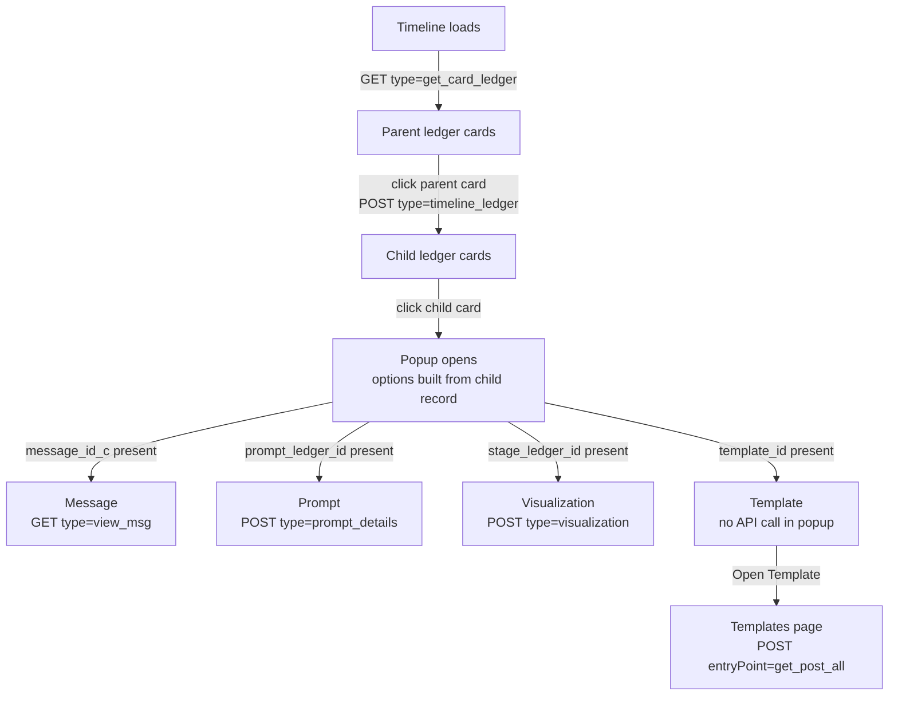

# Ledger Child Card Popup — Options & Endpoints

When a user clicks a ledger **child card**, a popup opens with up to four options: **Message**, **Prompt**, **Visualization** and **Template**. Each option appears only if the child record has the ID that option needs, and each option loads its own data from its own endpoint.

---

## 1. End-to-end flow

1. The timeline loads the **parent** ledger cards for the contact.
2. Clicking a parent card loads its **child** cards.
3. Clicking a child card opens the popup. The options are decided from the child record's fields — no extra request is made for this.
4. Each option fetches its own data the first time it is shown (not when the popup opens).

### How requests are sent

All `type=...` calls go to the configured CRM endpoint with:

- Header: `X-Api-Key`
- Query params always appended: `db_name`, `dash_user_email`
- The `type` query param selects the backend action — so "which endpoint" below means "which `type` value".

The Template flow is the one exception; it uses `entryPoint=get_post_all` (see section 4.4).

---

## 2. Loading the cards

### Parent cards

| | |
|---|---|
| **Endpoint** | `type=get_card_ledger` |
| **Method** | `GET` |
| **Params** | `email`, `page`, `page_size=10` |

### Child cards (on parent click)

| | |
|---|---|
| **Endpoint** | `type=timeline_ledger` |
| **Method** | `POST` |
| **Params** | `page`, `page_size=10` |
| **Body** | `{ "id": "<parent id>" }` |

Children load 10 per page; the next page loads automatically when the user scrolls near the last child. Pagination continues while `current_page < total_pages`.

---

## 3. Which options show in the popup

Each child record is checked for four fields, in this fixed order:

| Order | Option | Shown when the child has | ID passed to the option |
|---|---|---|---|
| 1 | Message | `message_id_c` | `message_id_c` (plus `thread_id_c`) |
| 2 | Prompt | `prompt_ledger_id` | `prompt_ledger_id` |
| 3 | Visualization | `stage_ledger_id` | `stage_ledger_id` |
| 4 | Template | `template_id` | `template_id` |

- **Default option:** the first available option in the table above is selected when the popup opens. A child with a message always opens on Message; a child with only a prompt and a template opens on Prompt.
- **Switching:** clicking another option loads that option's data at that moment.
- **Closing:** clicking outside the popup or the ✕ button closes it. Only one child popup can be open at a time.
- **Edge case:** a child with none of the four fields still opens the popup, but with no options and an empty body.

---

## 4. What each option does

### 4.1 Message

| | |
|---|---|
| **Endpoint** | `type=view_msg` |
| **Method** | `GET` |
| **Params** | `message_id=<message_id_c>` |
| **Cached** | Yes — reopening the same message does not refetch |

**Response fields used**

| Field | Used for |
|---|---|
| `email.body_html` → `email.body` → `email.content` | Message body (first non-empty one) |
| `email.subject` | Subject line |
| `email.from_name` | Sender name |
| `email.from_addr` | Sender email |
| `email.date_created` | Date and time |

**What the user sees:** sender, sender email, date/time, subject and the HTML body (style, script and comment tags are stripped first).

- No body in the response → "Thread Is Either Missing Or Deleted."
- Request fails → "No Content Available"

**Action inside:** the compose icon (with the unread count badge) opens the full thread view at `/thread/view` for this contact and `thread_id_c`. The click itself makes no API call.

---

### 4.2 Prompt

| | |
|---|---|
| **Endpoint** | `type=prompt_details` |
| **Method** | `POST` |
| **Body** | `{ "id": "<prompt_ledger_id>" }` |
| **Cached** | No — refetched every time the option is opened |

**Response handling:** used only when `success` is `true`. The record is read from `Prompt[0]`, falling back to `prompt_details[0]`.

**What the user sees:** one panel per non-empty field from this list:

| Field | Notes |
|---|---|
| `response` | Always shown first |
| `full_prompt` | Shows word and line count |
| `system_prompt` | Shows word and line count |
| `user_prompt` | Shows word and line count |
| `static_prompt` | Shows word and line count |

JSON values are pretty-printed.

**Actions inside** (shown only when the record has `prompt_id`):

| Button | Goes to | Data carried |
|---|---|---|
| **Edit** | `/settings/machine-learning` | `promptId = prompt_id`, `promptStatus = prompt_stage` |
| **Explore** | `/settings/prompt-explorer` | `system` and `user` prompt text |

For **Explore**, `system_prompt` and `user_prompt` are used when present. Otherwise `full_prompt` is split into system and user parts on the long dashed separator line (70 `-` characters).

---

### 4.3 Visualization

| | |
|---|---|
| **Endpoint** | `type=visualization` |
| **Method** | `POST` |
| **Body** | `{ "id": "<stage_ledger_id>" }` |
| **Cached** | No |

**Response handling:** used only when `success` is `true`. Data is read from `visualization` — an array of steps.

**What the user sees:** the steps as a numbered vertical flow.

| Step field | Used for |
|---|---|
| `process_no` | Sort order and step number |
| `name` | Split on the first `:` → text before is the title, text after is the subtitle |
| `description` | Step detail; HTML tags stripped, objects pretty-printed, collapsed after 300 characters with an expand option |

A progress bar at the top shows "Step N of M" and follows the step nearest the top as the user scrolls.

---

### 4.4 Template

The Template option makes **no API call inside the popup**. It shows a single **Open Template** button.

**On click:** navigates to `/settings/templates`, carrying `templateId = <template_id>`.

**On the Templates page**, the template is then fetched:

| | |
|---|---|
| **Endpoint** | `<CRM URL>?entryPoint=get_post_all&action_type=get_data` |
| **Method** | `POST` |
| **Header** | `x-api-key` (deal API key — different from the `type=` calls) |
| **Body** | `{ "module": "EmailTemplates", "where": { "id": "<template_id>" } }` |
| **Cached** | Yes, for 10 minutes |

The first record in the response opens in the template viewer. Closing the viewer sends the user back to the timeline.

---

## 5. Endpoint summary

| When | Endpoint | Method | Payload |
|---|---|---|---|
| Timeline loads | `type=get_card_ledger` | GET | `email`, `page`, `page_size=10` |
| Parent card clicked | `type=timeline_ledger` | POST | params `page`, `page_size=10`; body `{ id: <parent id> }` |
| Message option shown | `type=view_msg` | GET | `message_id=<message_id_c>` |
| Prompt option shown | `type=prompt_details` | POST | body `{ id: <prompt_ledger_id> }` |
| Visualization option shown | `type=visualization` | POST | body `{ id: <stage_ledger_id> }` |
| Templates page opened from Template option | `entryPoint=get_post_all&action_type=get_data` | POST | body `{ module: "EmailTemplates", where: { id: <template_id> } }` |

Every request also carries `db_name` and `dash_user_email`.
